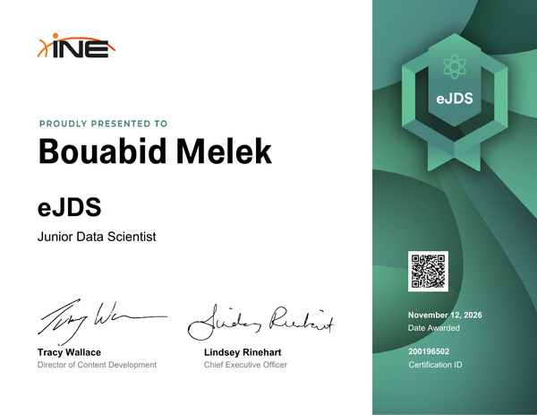
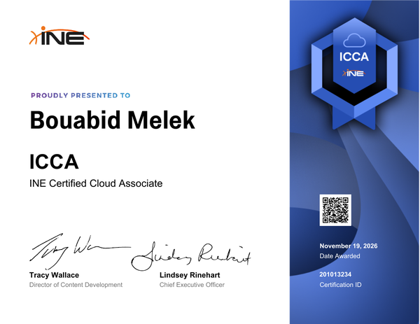
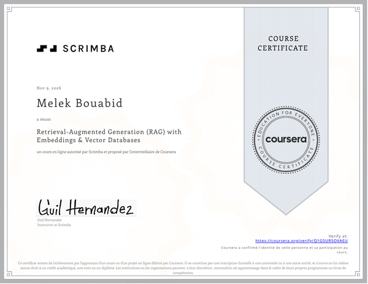
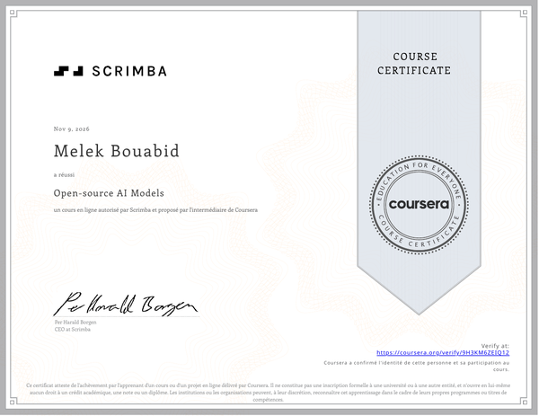
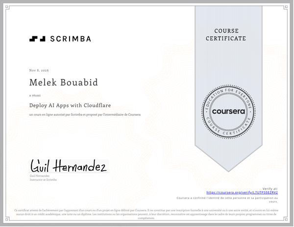

<h1 align="center">Hi, I'm Melek Bouabid 👋</h1>

<h3 align="center">Engineering Student — Data Science & Artificial Intelligence</h3>

  5th-year Computer Engineering student at Tek-Up (Tunisia), specialized in Data Science & AI.
   
  Coming from an atypical background (B.Sc. in Environmental Physics-Chemistry), which gave me a rigorous,
  analytical approach to problem-solving. I've worked across the full ML/AI lifecycle — from data preparation
  and model training to deployment via APIs — and built computer vision pipelines, RAG-based AI agents, fullstack
  applications, and NLP systems through both internships and hands-on academic projects.

  
  
  

---

### 🎓 Education

- **Computer Engineering — Data Science & AI**, Tek-Up, Tunisia *(2024 – June 2027, 5th year)*
- **B.Sc. in Environmental Physics-Chemistry**, Higher Institute of Environmental Sciences and Technologies of Borj Cédria *(2023)*
- **Baccalaureate**, Mathematics track *(2019)*

---

### 🛠️ Tech Stack

**Languages**

**Frameworks**

**Machine Learning / Data**

**Deep Learning**

**Generative AI / RAG**

**Big Data**

**Frontend**

**Databases**

**Tools & MLOps**

---

### 📜 Certifications

**INE professional certifications** (exam-based) — click a certificate or its name to verify it.

<table>
<tr>
<td align="center" width="50%">
 
<a href="https://certs.ine.com/9ed032ee-82d8-4e80-a817-c3f6548569c1"><b>eJDS — Junior Data Scientist</b></a> 
INE · Nov 2026 · ID 200196502
</td>
<td align="center" width="50%">
 
<a href="https://certs.ine.com/459386b2-1f67-4907-8ed1-e5a7753b16ee"><b>ICCA — INE Certified Cloud Associate</b></a> 
INE · Nov 2026 · ID 201013234
</td>
</tr>
</table>

**Generative AI courses** (Scrimba · Coursera)

<table>
<tr>
<td align="center" width="25%">
 
<a href="https://coursera.org/verify/Q1G5UR5OVAEU"><b>Retrieval-Augmented Generation (RAG) with Embeddings & Vector Databases</b></a>
</td>
<td align="center" width="25%">
 
<a href="https://coursera.org/verify/5TUUORIMLGT4"><b>Intro to AI Engineering</b></a>
</td>
<td align="center" width="25%">
 
<a href="https://coursera.org/verify/9H3KM6ZEIQ12"><b>Open-source AI Models</b></a>
</td>
<td align="center" width="25%">
 
<a href="https://coursera.org/verify/L7UTP5SEZRV2"><b>Deploy AI Apps with Cloudflare</b></a>
</td>
</tr>
</table>

---

### 💼 Experience

- **Data Science / AI Intern — STIET-Philips** *(2026, 2 months)*
  Contributed to a smart CMMS proof-of-concept (Laravel 12) for tracking medical installations (MRI and CathLab
  rooms). Implemented a documentary RAG-based conversational assistant (indexing, chunking, semantic retrieval,
  answer generation via the Gemini API), designed equipment-risk and team-performance scoring models, and
  contributed to an interactive installation-readiness graph with status indicators.

- **Mobile Development Intern (Flutter) — Advanced Technologies Software** *(2025, 1 month)*
  Built a Flutter mobile app for Ray-Ban enabling in-store barcode/QR code scanning and real-time stock
  availability checks, including the camera/scanning module and backend communication logic.

- **Chemistry Intern — Hekma (medical company)** *(2022, 1 month)*
  Product preparation and quality control in a laboratory setting.

---

### 🚀 Featured Projects

#### 💊 [Tujya — Pill Identification with Computer Vision & a Medication AI Agent](https://github.com/melekbouabid/syRX)
Solo project (Tek-Up, 2026). Snap a photo of one or more pills: a **YOLO11** model detects each pill and an
**EfficientNetV2-S** classifier trained by transfer learning identifies it among 380 pills of the public NLM C3PI
dataset (top-1 0.909), always showing its confidence. Tujya then checks drug–drug interactions (DDInter) and a
**LangGraph agent** answers follow-up questions with **hybrid RAG** (Qdrant, BM25, reranker) over openFDA labels and
PubMed, citing its sources and never giving a dosage. Full MLOps: DVC, MLflow Model Registry (champion/challenger),
5 detectors and 6 classifiers compared with Optuna, ONNX export, drift monitoring (KS, PSI), RAGAS evaluation,
an MCP server, GitHub Actions CI/CD and the whole stack in one Docker Compose command.

#### ☀️ [SolarVision — Photovoltaic Production Forecasting](#)
Time series forecasting project (Tek-Up, 2026) on the daily production of a 1 kWp PV system in 9 cities across France, Tunisia and Spain, 2005–2023
(PVGIS, ERA5/Open-Meteo, NASA POWER, RTE data). Benchmarked 14 models at 1–7 day horizons, including persistence, climatology, ARIMA-Fourier, SARIMAX, VAR,
Prophet, XGBoost, LSTM, GRU, hybrid ARIMA + LSTM and a global multi-city LSTM, evaluated with a chronological 90/10 split, walk-forward origins, RMSE/MAE/MAPE,
Diebold-Mariano tests with Holm correction and calibrated 95% prediction intervals (seasonal variance + GARCH), with analyses in R and Python (ADF/KPSS, STL, Granger, Johansen/VECM, GARCH).
Every model beats persistence (p < 0.001), and knowing the upcoming weather cuts RMSE by about a third. MLOps pipeline with data quality gates, isolated training,
a versioned model registry (SHA-256 manifest), atomic promotion and rollback and GitHub Actions CI, served by a FastAPI + React app with a RAG assistant (BM25 + LLM), containerized with Docker.

#### 🔎 [CSIS — Criminal Study Intelligent System](#)
Trained and compared supervised ML models (XGBoost, Random Forest; 98.2% accuracy on the risk score) to detect social risk among young people,
with data cleaning, feature engineering and NLP for text content analysis. Also designed an intelligent legal
assistant on a RAG architecture (LangChain + vector database) grounded in Tunisian law, reducing hallucination
risk, with results presented through a Streamlit interface and a Power BI dashboard.

#### 🏠 [The Room — Escape Game Booking Website](#)
Full-stack booking platform with a public site (React) and admin dashboard, an Express + PostgreSQL backend
containerized with Docker, real-time notifications (SSE), and PDF/Excel data export.

#### 🚲 [E-Bike Rental Platform](#)
Peer-to-peer electric bike rental marketplace built with Django REST Framework and React/TypeScript, including
JWT authentication and Stripe payment integration.

#### 🗂️ [Generator Data Crime](#)
React/Vite application generating synthetic criminology datasets (JSON/CSV) with realistic statistical
correlations, used to test data processing pipelines and analytical dashboards.

---
  
### 🌐 Languages

- 🇹🇳 Arabic — Native
- 🇫🇷 French — Fluent
- 🇬🇧 English — Fluent

---

<i>Open to opportunities in Data Science, AI, and fullstack development.</i>

